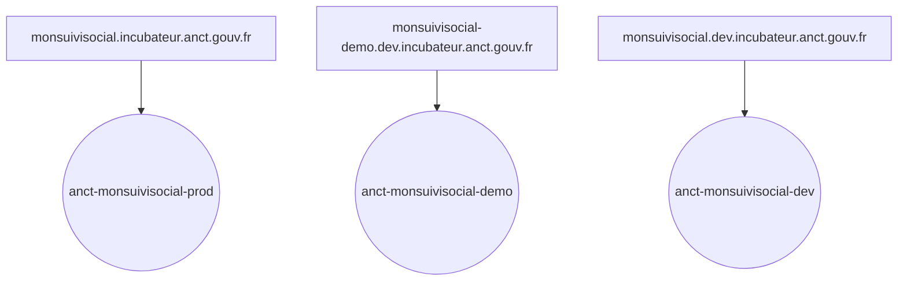
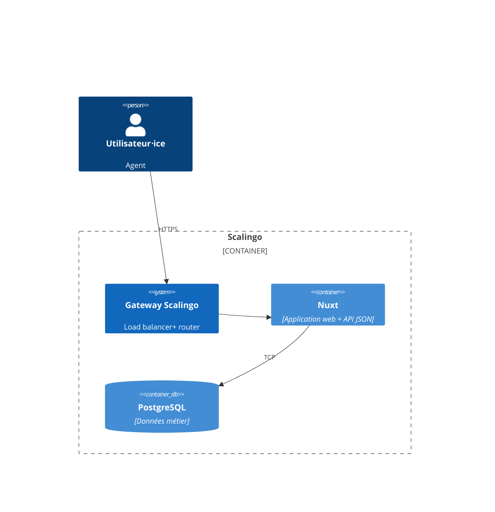
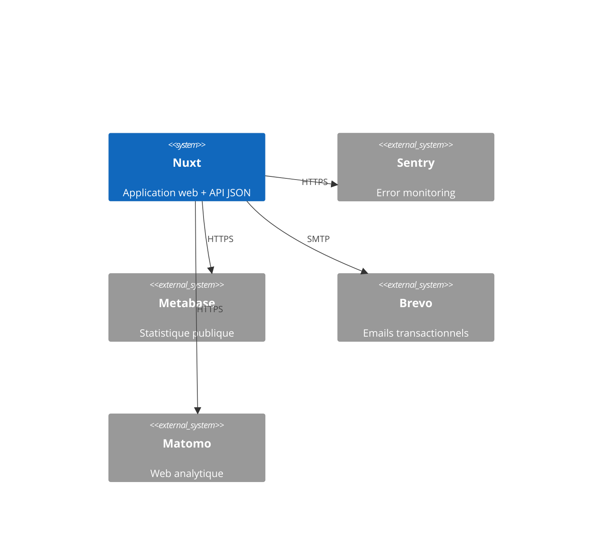
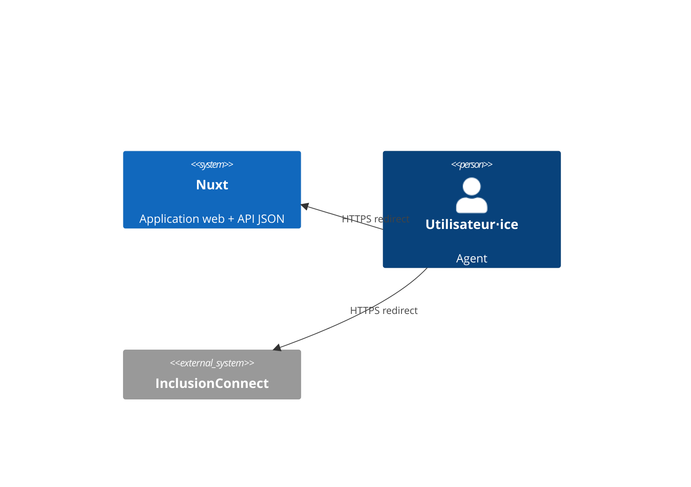
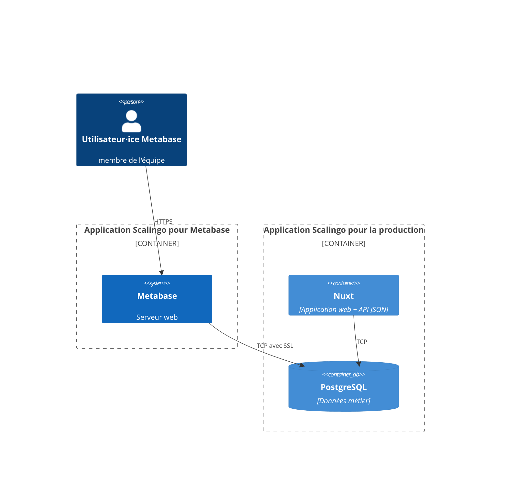

# Dossier technique

> Ce dossier a pour but de présenter l’architecture technique du SI. Il n’est par conséquent ni un dossier d’installation, ni un dossier d’exploitation ou un dossier de spécifications fonctionnelles.

**Nom du projet :** Mon Suivi Social

**Dépôt de code :** https://gitlab.com/incubateur-territoires/startups/monsuivisocial/monsuivisocial-v2

**Hébergeur :** Scalingo, Paris (région Scalingo "osc-secnum-fr1", région Outscale "cloudgouv-eu-west-1")

**Décision d’homologation :** !!<date>!!

## Suivi du document

> Le suivi de ce document est assuré par le versionnage Git.

## Fiche de contrôle

> Cette fiche a pour vocation de lister l’ensemble des acteurs du projet ainsi que leur rôle dans la rédaction de ce dossier.

| Organisme                  | Nom                   | Rôle                   | Activité  |
|----------------------------|-----------------------|------------------------|-----------|
| Mon Suivi Social           | Thomas Glatt          | Lead tech              | Relecture + Rédaction |
| Mon Suivi Social           | Nayanka Bolnet        | Lead tech              | Relecture + Rédaction |
| Mon Suivi Social           | Clara Dumont          | Product Manager        | Relecture |
| Incubateur des territoires | Florian Busi          | Consultant SSI         | Relecture |

## Description du projet

Il est open source, bien que toutes les instances soient gérées par l'équipe.

Plus d'infos sur la fiche beta : https://beta.gouv.fr/startups/mon-suivi-social.html

## Architecture

### Stack technique

Le projet est un monolithe [Nuxt](https://nuxt.com/) avec une base Postgres pour les données métier. L'infrastructure est entièrement gérée par Scalingo en PaaS.
[Nuxt](https://nuxt.com/) peut fonctionner en mode SSR (Server Side Rendering). C'est à dire que le HTML peut être généré soit du coté du serveur, soit du coté du navigateur. On distinguera donc deux parties:
- Nuxt client: code pouvant être executé coté serveur ou coté navigateur
- Nuxt server: code s'excutant uniquement coté serveur

Le projet est écrit en [Typescript](https://www.typescriptlang.org/).

Les briques structurantes du projet sont:
- l'ORM [Prisma](https://www.prisma.io/)
- [trpc](https://trpc.io/) permet de typer les API de bout en bout

### Matrice des flux

#### Applications métier sur Scalingo

| Source           | Destination       | Protocole | Port | Localisation      | Interne/URL Externe |
|------------------|-------------------|-----------|------|-------------------|---------------------|
| Navigateur       | Nuxt client       | HTTPS     | 443  | Paris/SecNumCloud | Externe             |
| Nuxt server      | Postgres Scalingo | TCP       | 5432 | Paris/SecNumCloud | Interne             |
| Nuxt client      | Metabase          | HTTPS     | 443  | Paris/SecNumCloud | Externe             |
| Metabase         | Postgres Scalingo | TCP       | 5432 | Paris/SecNumCloud | Interne             |

#### Tooling (error monitoring)

| Source      | Destination | Protocole | Port | Localisation              | Interne/URL Externe                             |
|-------------|-------------|-----------|------|---------------------------|-------------------------------------------------|
| Nuxt client | Sentry      | HTTPS     | 443  | Tours, France             | sentry.incubateur.net                           |
| Nuxt server | Sentry      | HTTPS     | 443  | Tours, France             | sentry.incubateur.net                           |
| Nuxt client | Matomo      | HTTPS     | 443  | Tours, France             | https://matomo.incubateur.anct.gouv.fr          |

#### Services externes

| Source                            | Destination                | Protocole     | Port | Localisation        | Interne/URL Externe                 |
|-----------------------------------|----------------------------|---------------|------|---------------------|-------------------------------------|
| Nuxt Server                       | Brevo                      | SMTP          | 587  | Paris, France       | smtp-relay.sendinblue.com           |

Note : l'application expose aussi une API `https://monsuivisocial.incubateur.anct.gouv.fr/api/structures` qui retourne les structures utilisatrices du service. Cette API est protégée par un système de token.

#### Fournisseurs d'identité

| Source     | Destination      | Protocole     | Port | Localisation        | Interne/URL Externe            |
|------------|------------------|---------------|------|---------------------|--------------------------------|
| Navigateur | InclusionConnect | HTTPS (OAuth) | 443  | France              | connect.inclusion.beta.gouv.fr |

### Inventaire des dépendances

| Nom de l’applicatif | Service          | Version   | Commentaires                                                    |
|---------------------|------------------|-----------|-----------------------------------------------------------------|
| Serveur web         | Nuxt @ Scalingo  | Nuxt 3    | Voir ci-dessous pour le détail des librairies                   |
| BDD métier          | PostgreSQL       | `14.11.0` | Stockage des données métier, voir [/prisma/schema.prisma](/prisma/schema.prisma) |

La liste des librairies JS est disponible dans :
- [package.json](/package.json) pour la liste des dépendances directes
- [pnpm-lock.yaml](/pnpm-lock.yaml) pour la liste complète des librairies utilisées directement et indirectement (dépendances
  indirectes), et leurs versions précises

### Schéma de l’architecture

Notre application est accessible à l'adresse: https://monsuivisocial.incubateur.anct.gouv.fr/

Nous avons actuellement 3 instances :
- `anct-monsuivisocial-prod` : serveur de production pour `https://monsuivisocial.incubateur.anct.gouv.fr`
- `anct-monsuivisocial-demo` : serveur de demo pour `https://monsuivisocial-demo.dev.incubateur.anct.gouv.fr`
- `anct-monsuivisocial-dev` : serveur de dev pour `https://monsuivisocial.dev.incubateur.anct.gouv.fr`

`anct-monsuivisocial-prod` est notre instance de production actuelle. Elle est représentée fidèlement dans les
schémas ci-dessous. 

L'instance `anct-monsuivisocial-demo` sert de plateforme de démo, elle est toujours à la même version que la production

L'instance `anct-monsuivisocial-dev` est la plateforme de dev. Elle permet de tester les évolutions en cours de développement.

#### Architecture interne à Scalingo

#### Échanges entre l'app et les services externes

#### Échanges entre l'app, les fournisseurs d'identités, et les utilisateur⋅ices

#### Échanges entre l'app et Metabase

Notre équipe utilise Metabase pour réaliser des statistiques afin de suivre l'utilisation de l'application et produire les statistiques publiques accessibles  à l'adresse `https://monsuivisocial.dev.incubateur.anct.gouv.fr/statistiques`

### Gestion DNS

C'est **Gandi (gandi.net)** qui fournit nos noms de domaine et la gestion DNS.

Nous y gérons les domaines suivants :
- `monsuivisocial.incubateur.anct.gouv.fr` : domaine de production
- `monsuivisocial-demo.dev.incubateur.anct.gouv.fr` : domaine de démonstration
- `monsuivisocial.dev.incubateur.anct.gouv.fr` : domaine de developpement

### Schéma des données

Lancer `npx prisma generate` pour obtenir un SVG de l'état actuel des tables Postgres. Le fichier `prisma/schema.prisma` donne aussi une description des tables.

Le dernier fichier commité est [docs/database-model.svg](docs/database-model.svg)

## Exigences générales

### Accès aux serveurs et sécurité des échanges

Les serveurs (applicatif et base de données) sont gérés par Scalingo. Scalingo ne fournit pas de système de rôle : soit
on a accès à une app, soit on ne l'a pas.

Nous avons actuellement 4 apps Scalingo:

- `osc-secnum-fr1/anct-monsuivisocial-prod`
- `osc-secnum-fr1/anct-monsuivisocial-metabase-prod`
- `osc-fr1/anct-monsuivisocial-demo`
- `osc-fr1/anct-monsuivisocial-dev`

Le fait d'avoir accès à une app Scalingo donne les droits suivants :

- augmenter ou réduire le nombre d'instances applicatives de l'app / régler les paramètres d'autoscaling
- administrer la base Postgres (changer la taille de l'instance, mettre à jour Postgres, télécharger des backups, etc)
- administrer la base Redis (même fonctionnalités que pour Postgres ci-dessus)
- visualiser les déploiements passés ou en cours
- configurer le déploiement automatique d'une branche GitHub
- visualiser l'activité de l'app (scaling, déploiements, commandes lancées en one-off)
- visualiser les logs (app + jobs + routeur Scalingo) et en télécharger des archives
- visualiser des metrics (requêtes par minute, temps de réponse, CPU, RAM)
- lire et modifier les variables d'environnements
- octroyer aux équipes support Scalingo le droit d'accéder à l'environnement d'exécution de l'application et aux
  métadonnées et aux données de surveillance des bases de données
- ajouter ou supprimer des collaborateurs sur l'app
- ajouter au supprimer les domaines autorisés à pointer vers l'app
- gérer les alertes

Les accès Scalingo sont octroyés uniquement à l'équipe technique ("devs") car iels en ont besoin de tout ou une partie
des fonctionnalités listées afin de :

- surveiller la santé de l'app de production
- lancer une console distante en production afin d'investiguer des bugs
- ajouter ou mettre à jour des variables d'environnement
- vérifier le bon déploiement des nouvelles versions du code

#### Détection de fuite de secrets

Nous avons un job de détection de secret `GitLab secrets analyzer v6.0.0` configuré dans Gitlab Ci/CD. Ce système envoie des alertes et bloque le push si des secrets sont détectés dans un commit.

### Authentification, contrôle d’accès, habilitations et profils

L'application a 6 types d'utilisateurs :
- Responsable de structure
- Travailleur social
- Instructeur
- Agent d'accueil/CNFS
- Référent
- Admin
  
Les comptes utilisateurs ont une contrainte d'unicité sur les emails.

Les sessions sont déconnectées automatiquement en cas d'inactivité de l'utilisateur. On considère un utilisateur inactif lorsque la souris est immobile.

#### Les agents

Les agents ont accès à diverses fonctionnalités touchants à :
- l'accès à la liste des bénéficiaires
- l'accès à la fiche d'un bénéficiaire
- l'accès aux demandes d'aide d'un bénéficiaire
- l'accès aux synthèses d'entretien d'un bénéficiaire
- l'accès au budget d'un bénéficiaire
- la gestion des autres utilisateur de leur structure

Les règles d'accès à ces ressources sont complexes et dépendent de plusieurs niveaux d'accès attribués aux agents.

Ces règles d'accès sont directements gérées par l'application.

La connexion à un profil agent est faite par Inclusion Connect

#### Les admins

Une interface CRUD permettant de gérer l'ensemble des structures et
utilisateurs est proposée en interne à l'équipe.

Afin de s'y connecter, il faut utiliser se rendre sur la page `https://monsuivisocial.dev.incubateur.anct.gouv.fr/auth/admin`. Un système de lien magique envoyé par mail permet d'y accéder.

### Traçabilité des erreurs et des actions utilisateurs

#### Logs textuels

Les logs textuels sont écrits dans le système de log de Scalingo. Cela comprend :
- Les logs des commandes de la production (e.g. lancer la console)
- les changements de variables d'environnements

Les logs produits par le routeur de Scalingo contiennent, pour chaque requêtes HTTP :

- timestamp
- path HTTP
- méthode HTTP
- IP d'origine
- referer
- user agent

La consultation des logs textuels ne se fait que lors d'investigations de bugs. Leur usage est donc uniquement ponctuel
et leur consultation est manuelle. Nous n'avons pas de système d'analyse de logs.

#### Traçabilité applicative / auditing

Un mécanisme interne à l'application permet de stocker en base de données les actions des utilisateurs. Ces actions sont stockées dans la table `user_activity`.

Toutes les actions ne sont pas tracés. Seuls les actions de création et de modification le sont. A noter que chaque modification de données est stockée dans cette table.

#### Monitoring d'erreur

Nous utilisons Sentry afin d'être informé⋅es sur les nouvelles erreurs, et le volume des erreurs existantes.
Nous utilisons l'instance Sentry de l'incubateur beta.gouv (sentry.incubateur.net).

Notre hébergeur Scalingo propose aussi un système d'alerting déclenché selon des métriques diverses, mais
celui-ci n'est pas utilisé actuellement car sa calibration est difficile.

### Intégrité

Des backups de nos bases de données Postgres sont faîtes automatiquement par Scalingo. Ces backups sont
créés quotidiennement. La politique de retention des backups est la suivante:
- Backups journaliers conservés : 7 jours
- Backups hebdomadaires conservés : 8 semaines
- Backups mensuels conservés : 12 mois

Scalingo nous offre également la fonctionnalité de Point-in-time Recovery. Nous profitons également d'un système
de cluster avec 2 nodes, qui permet un failover automatique en cas de plantage d'une instance Postgres.

### Confidentialité

**L'application est conçue pour le suivi des bénéficiaires des CCAS. Nous manipulons donc des données sensibles.**

Parmi les données que nous manipulons, les plus critiques sont :
- les coordonnées des bénéficiaires
- l'historique des synthèses des entretiens
- l'historique des demandes d'aide
- des documents personnels du bénéficiaire